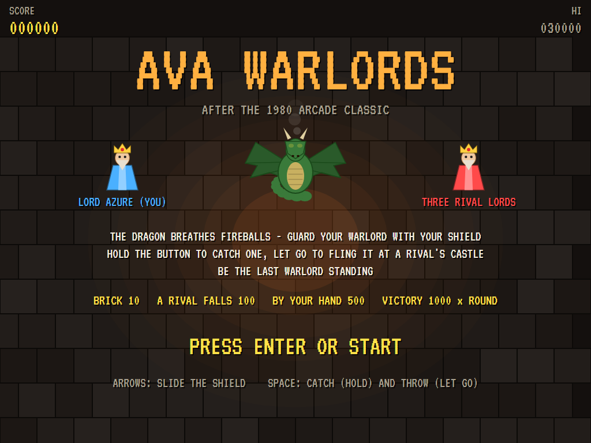
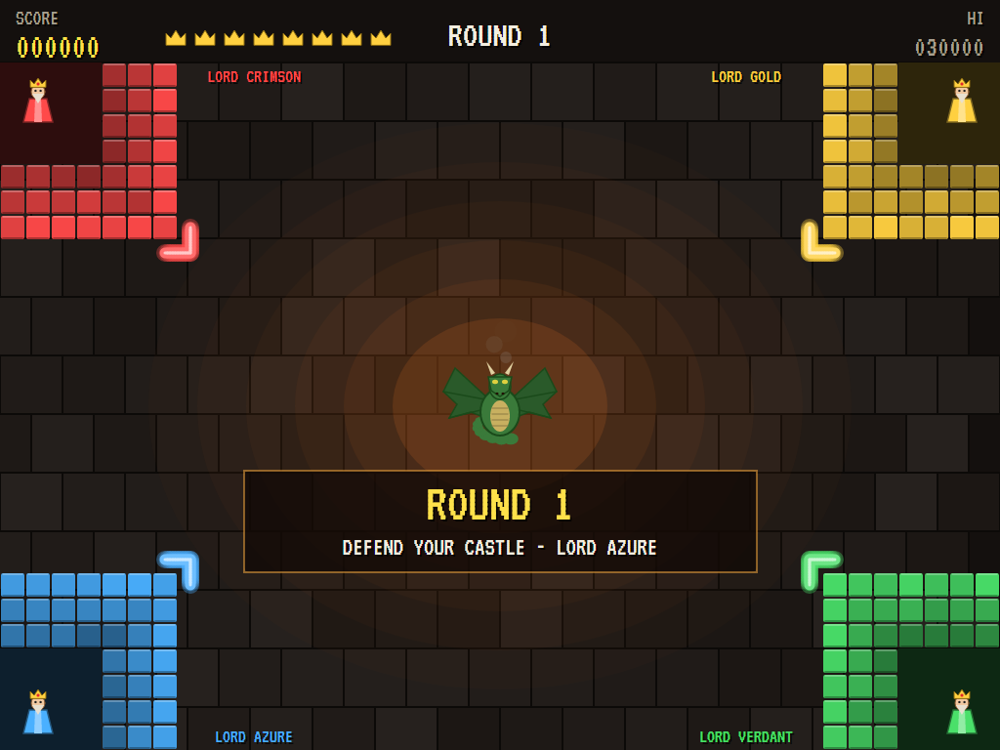
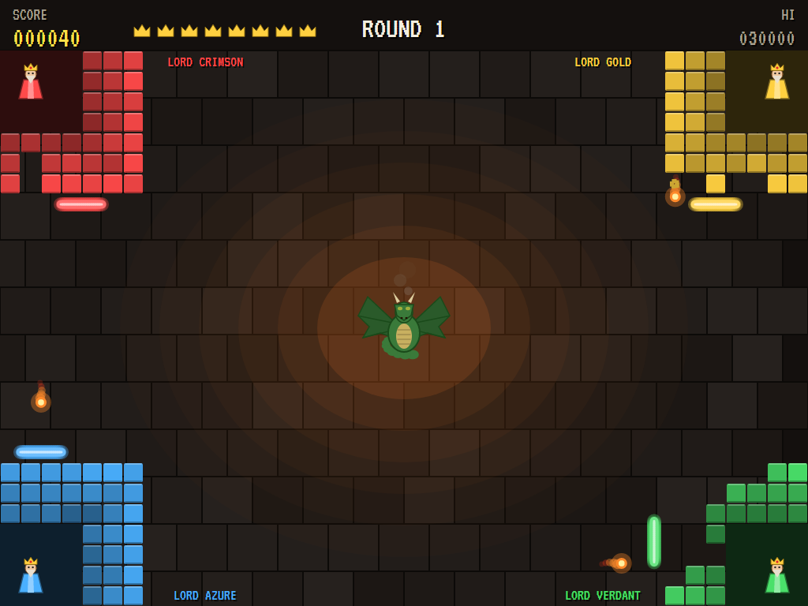
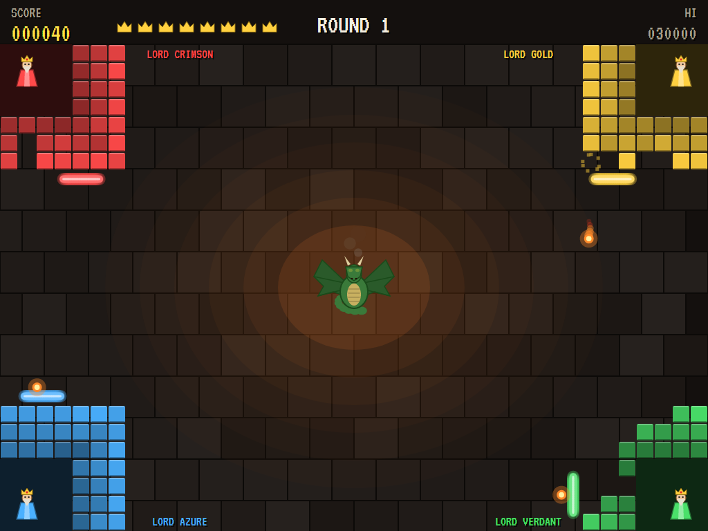
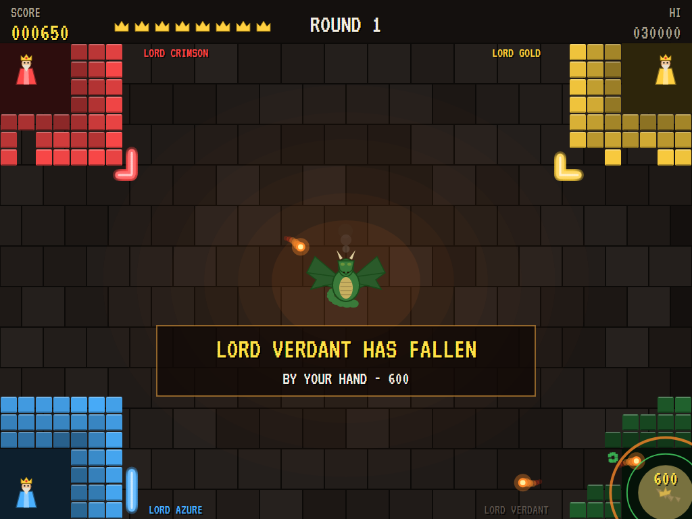
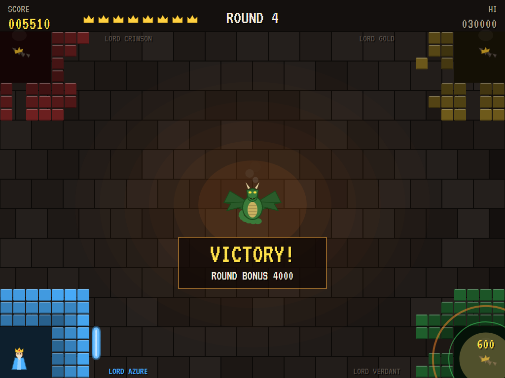
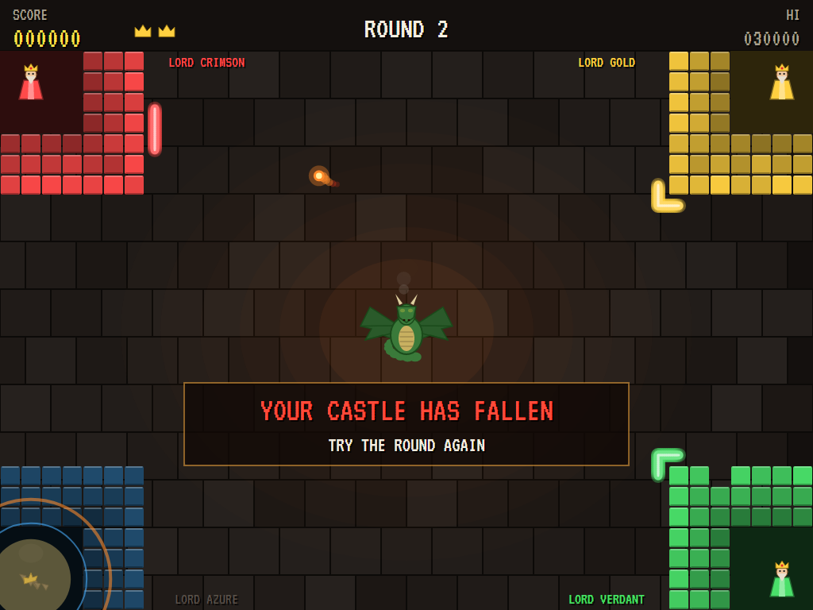
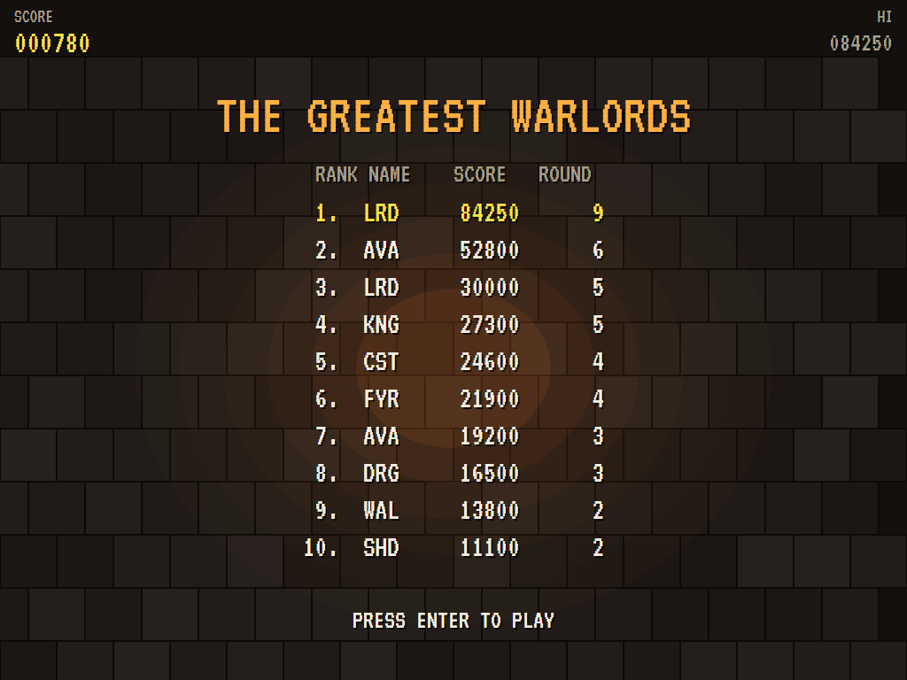

# AVA Warlords

[](https://github.com/Harlock123/AVAWarlords/actions/workflows/build.yml)

A four-castle battle in the style of Atari's 1980 arcade game **Warlords**, built with .NET 10 and
Avalonia UI. Four warlords sit behind their castle walls, one in each corner, while a dragon in the middle
breathes fireballs that smash through brickwork. Guard your warlord with your shield, catch a fireball and
fling it back at a rival's castle, and be the last warlord standing.

## Features

- **The castles**: one in each corner, each with a warlord behind three thick L-shaped walls of bricks. Every fireball that strikes a wall knocks a brick out and bounces back. Get one through to a warlord and his castle falls.
- **Your shield**:
  - **Moving it:** it slides round the outside of your castle (Lord Azure's, bottom left), up the side and along the top. Press up or left one way, down or right the other.
  - **Deflecting:** a fireball off the shield comes away faster, angled by where it struck.
  - **Catching:** hold the button and the shield catches a fireball and carries it. Let go and it flies off hard, out along the line from your warlord through the shield, so you can line up a throw at a rival's castle.
- **The rival lords**: Crimson, Gold and Verdant defend their castles. They judge where each fireball will come and slide their shields to meet it. Sometimes they catch one and fling it at someone else.
- **The dragon**: it sits coiled in the middle and breathes fireballs at the castles: one to start, more as the round goes on, and another whenever none are left. There are never more fireballs in play than castles standing. They grow fiercer the longer a round lasts.
- **Rounds**:
  - **Winning:** be the last castle standing to win the round. The next round brings quicker, sharper rivals.
  - **Losing:** if your castle falls you lose a life and fight the round again.
- **Scoring**:
  - Bricks 10 each (with your fireball)
  - 100 when a rival falls, plus 500 if it was your fireball that did it
  - 1,000 times the round number for a victory
  - An extra life at 15,000 and every 40,000 after that
- **Sound**:
  - **The music:** a stately dance over a drone for the battle, plus a herald's march for the title, all new.
  - **The effects:** shields, bricks, catches and throws, the dragon's roar, castles crashing down, and fanfares for victory and defeat.
  - All of it is synthesised and mixed by OpenAL.
- **Attract mode**: leave the title alone for 15 seconds and the computer defends your castle.
  - **Blocking:** it meets each fireball with the shield.
  - **Catching:** it catches one when nothing else is about to arrive.
  - **Throwing:** it swings round to fling the fireball at the rival with the least wall left.
- **A top-ten high-score table** with arcade-style initials entry. It records the round reached.
- **Gamepads** through SDL2, as well as the keyboard.
- **Any window size**: the screen scales to fit, letterboxed. **Ctrl+S** saves a screenshot.
- **One self-contained executable** per platform: Windows, macOS and Linux on Intel/AMD and ARM.

## Screenshots

| The title | Round 1 | The battle |
|:---------:|:-------:|:----------:|
|  |  |  |
| Four lords and a dragon. | Behind the walls. | Fireballs everywhere. |

| A catch | A castle falls | Victory |
|:-------:|:--------------:|:-------:|
|  |  |  |
| Held on the shield, ready to throw. | By your hand. | The last warlord standing. |

| Defeat | The greatest warlords | |
|:------:|:---------------------:|:-:|
|  |  | |
| Your castle has fallen. | The high-score table. | |

The screenshots are made by the tests, which play the game in a real (headless) window; see
[Tests](#tests).

## Download and run

Ready-to-run builds for Windows, macOS and Linux, on both Intel/AMD and ARM, are on the
[Releases page](https://github.com/Harlock123/AVAWarlords/releases/tag/latest). **Latest build** is rebuilt
on every push to `main`. Each download is one self-contained executable: no .NET install is needed.

| Platform | Archive |
|---|---|
| Windows | `AVAWarlords-win-x64.zip`, `AVAWarlords-win-x86.zip`, `AVAWarlords-win-arm64.zip` |
| macOS | `AVAWarlords-osx-arm64.tar.gz` (Apple silicon), `AVAWarlords-osx-x64.tar.gz` (Intel) |
| Linux | `AVAWarlords-linux-x64.tar.gz`, `AVAWarlords-linux-arm64.tar.gz`, `AVAWarlords-linux-arm.tar.gz` |

```bash
tar -xzf AVAWarlords-linux-x64.tar.gz     # or linux-arm64, linux-arm, osx-arm64, osx-x64
./AVAWarlords
```

On Windows, unzip and run `AVAWarlords.exe`. On macOS, if Gatekeeper refuses to open it, run
`xattr -d com.apple.quarantine AVAWarlords` once. Run with `--no-audio` for silence.

**Sound** comes through OpenAL Soft, built in for every platform. In a virtual machine the game
detects it and uses a larger audio buffer, so the sound doesn't break up.

**Gamepads** use SDL2, which is bundled for Windows, macOS and Intel/AMD Linux. ARM Linux builds need it
installed; without it the keyboard still works:

```bash
sudo apt install libsdl2-dev            # Debian / Ubuntu / Raspberry Pi OS
sudo pacman -S --needed sdl2-compat     # Arch / Omarchy
```

## Controls

| Input | Action |
|-------|--------|
| **Enter** | Start |
| **Up** / **Left** (or **W** / **A**) | Slide the shield one way round the castle |
| **Down** / **Right** (or **S** / **D**) | Slide it the other way |
| **Space** / **Z** / **X** / **Ctrl** | Hold to catch a fireball; let go to throw it |
| **P** / **Esc** | Pause (Esc again to quit) |
| **M** | Mute |
| **Ctrl+S** / **Cmd+S** | Save a screenshot to the Pictures folder |

**Gamepad**: left stick or D-pad to slide the shield, **A**, **B** or **X** to catch and throw, **Start** to
start and pause, **Back** (while paused) to quit.

**Entering initials**: type letters, or dial with **Up**/**Down** and accept with **Space**; **Left** /
**Backspace** go back; **Enter** finishes.

## Tests

```bash
dotnet test AVAWarlords.slnx
```

The engine has no UI and runs in fixed 60 Hz steps, so it plays the same at any frame rate, and a seed
always plays the same game. The tests check:

- **The castles:** four in the corners, each with three walls round its warlord
- **Your shield:**
  - sliding round and stopping at the ends
  - fireballs bouncing off it outward, faster, and becoming yours
  - catching and throwing out from the warlord, harder
- **Bricks and warlords:**
  - a brick knocked out and the fireball bouncing back, 10 if it was yours
  - a fireball through to a warlord bringing the castle down, more if it was yours
- **Rounds:**
  - losing your castle costing a life and the round fought again, and the last life ending the game
  - the last castle standing winning the round and its bonus
- **The dragon:** breathing at the start and whenever none are left, and never more fireballs than castles; fireballs never settling into going straight across
- **The rivals:** sliding to meet a fireball, and aiming a throw at a rival's warlord
- **The machine:** an extra life, the computer winning rounds at your castle, the attract cycle, the same game from the same seed, initials and the high-score file

The screenshot tests draw the real screen in a headless window. To refresh the README's pictures:

```bash
WARLORDS_SHOTS=$PWD/Images dotnet test tests/AVAWarlords.Tests --filter ScreenshotTests
```

To see how the computer gets on at your castle, round by round (for tuning), or how a player who never moves
does (`WARLORDS_PROBE=lazy`):

```bash
WARLORDS_PROBE=1 dotnet test tests/AVAWarlords.Tests --filter PilotProbe --logger "console;verbosity=detailed"
```

## Building

```bash
dotnet build AVAWarlords.slnx
dotnet run --project src/AVAWarlords
```

Needs the .NET 10 SDK. The sounds are made by `tools/make_sounds.py` (standard-library Python):
`python3 tools/make_sounds.py` rewrites `src/AVAWarlords/Sounds`.

## Project structure

```
AVAWarlords/
├── AVAWarlords.slnx
├── src/AVAWarlords/
│   ├── Engine/
│   │   ├── GameEngine.cs        # States, the title and demo cycle, and the music
│   │   ├── GameEngine.Play.cs   # Shields, catching and throwing, fireballs, bricks and warlords,
│   │   │                        # the dragon, the rival lords, rounds and scoring
│   │   ├── WarlordPilot.cs      # The computer at your castle, for the demonstration (and the tests)
│   │   ├── Entities.cs          # The field, castles and their cells, the shield's path, fireballs
│   │   ├── HighScoreTable.cs, InitialsEntry.cs
│   │   ├── InputHandler.cs, ControllerManager.cs  # Keys and an SDL2 gamepad
│   │   └── SoundManager.cs      # Effects and the tunes through OpenAL
│   ├── Audio/                   # The OpenAL engine (from the author's AVABand)
│   ├── Views/                   # The flagstones, castles and warlords, the dragon, fireballs, the screens
│   └── Sounds/                  # The synthesised effects and tunes
├── tests/AVAWarlords.Tests/     # Gameplay, screenshot and probe tests
├── tools/make_sounds.py
└── Images/                      # Screenshots
```

## About and licence

AVA Warlords © 2026 Lonnie Watson, under the [MIT License](LICENSE).

*Warlords* © 1980 Atari; the name belongs to its current owner. AVA Warlords is an independent, unofficial
game in its style. Its lords, castles, dragon, graphics, sounds, tunes and code are its own; nothing is
taken from the arcade machine's program, graphics, sound or music. It is not affiliated with or endorsed by
any rights holder.
